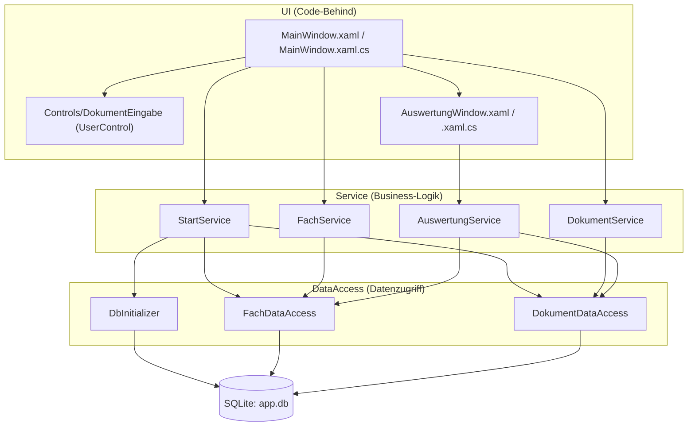

# K1 - Schichtenarchitektur

Die App ist in drei Schichten aufgeteilt. Jede Schicht kennt nur die direkt
darunterliegende - nie umgekehrt, und keine Schicht wird übersprungen.

## Schichtendiagramm

Die Klassen in `Models/` (`Fach`, `Dokument`, `FachAuswertung`) sind reine Datenobjekte und werden
von allen Schichten verwendet.

## Wer ruft wen?

| Serviceklasse   | Service-Methode                                   | Ruft auf in DataAccess                                  |
|-----------------|---------------------------------------------------|---------------------------------------------------------|
| StartService    | Initialisiere()                                   | DbInitializer.Initialize(), FachDataAccess.GetAll(), FachDataAccess.Add(), DokumentDataAccess.Add() |
| FachService     | GetAlle()                                         | FachDataAccess.GetAll()                                 |
| FachService     | Hinzufuegen(name, lehrperson)                     | FachDataAccess.ExistiertName(name), FachDataAccess.Add(fach) |
| FachService     | Loeschen(fachId)                                  | FachDataAccess.Delete(fachId)                           |
| DokumentService | GetByFach(fachId)                                 | DokumentDataAccess.GetByFach(fachId)                    |
| DokumentService | GetOffeneFristen()                                | DokumentDataAccess.GetOffeneFristen()                   |
| DokumentService | Hinzufuegen(titel, typ, dateipfad, frist, fachId) | DokumentDataAccess.Add(dokument)                        |
| DokumentService | Loeschen(dokumentId)                              | DokumentDataAccess.Delete(dokumentId)                   |
| DokumentService | AbgabeUmschalten(dokument)                        | DokumentDataAccess.SetAbgegeben(id, neuerStatus)        |
| DokumentService | MarkiereAlsAbgegeben(dokumentId)                  | DokumentDataAccess.SetAbgegeben(id, true)               |
| DokumentService | ZaehleOffene(dokumente)                           | - (rechnet auf der bereits geladenen Liste)             |
| DokumentService | ZaehleUeberfaellige(dokumente)                    | - (rechnet auf der bereits geladenen Liste)             |
| AuswertungService | GetAuswertungProFach()                          | FachDataAccess.GetAll(), DokumentDataAccess.GetAll()    |
| AuswertungService | GetGesamtauswertung()                           | DokumentDataAccess.GetAll()                             |

## Was liegt wo?

- **UI:** Klicks entgegennehmen, Eingaben weiterreichen, Listen und Statuszeile
  aktualisieren, Rückfragen (MessageBox). Kein SQL, kein `using SchulApp.DataAccess`.
- **Service:** Regeln (Name/Titel nicht leer, Fachname eindeutig, Standardtyp
  "Auftrag"), Speicherformat der Frist, Abgabe-Workflow, Ablauf beim Programmstart.
  Regelverletzungen werden als `ValidierungsException` gemeldet, die UI zeigt sie
  als Hinweis.
- **DataAccess:** sämtliche Datenbankzugriffe und die Verbindung zur SQLite-Datenbank
  (in K1 als SQL-Befehle, seit K2 über EF Core und LINQ).

## Kontrolle (B4)

Suche nach `Sqlite` in `MainWindow.xaml.cs` und im Ordner `Services/`: keine Treffer.
Dasselbe gilt für `AuswertungWindow.xaml.cs` und `Controls/DokumentEingabe.xaml.cs`.

## Challenge: Zweite Serviceklasse

`AuswertungService` ist eine eigenständige Serviceklasse für die Auswertung des
Abgabestands. Sie ändert nichts an den Daten, sondern rechnet nur:

- `GetAuswertungProFach()` liefert pro Fach die Anzahl Dokumente, abgegebene,
  offene und überfällige Dokumente sowie den Fortschritt in Prozent.
- `GetGesamtauswertung()` liefert dieselben Kennzahlen über alle Fächer.

Verwendet wird sie im Fenster **Auswertung > Abgabestand pro Fach…**
(`AuswertungWindow`): eine Tabelle mit einer Zeile pro Fach inkl.
Fortschrittsbalken und einer Summenzeile. Es gelten dieselben Regeln wie für die
anderen Services: Das Fenster kennt nur `AuswertungService`, der Service spricht
nur über `FachDataAccess` und `DokumentDataAccess` mit der Datenbank.

## Vertiefung C: Mehrere Projekte in einer Solution

Nicht umgesetzt (freiwillig). Service- und DataAccess-Schicht liegen weiterhin
als Ordner im WPF-Projekt.

## Reflexion & KI-Protokoll (K1)

Fortsetzung des Protokolls aus `K0_KI_Protokoll.md`.

| Nr | Thema | Prompt (Kernfrage) | Was die KI geliefert hat | Gut / korrigiert | Gelernt |
|----|-------|--------------------|--------------------------|------------------|---------|
| K1-1 | Analyse (Prompt 1) | _TODO Team: Prompt aus dem ursprünglichen K1-Umbau_ | _TODO_ | _TODO_ | _TODO_ |
| K1-2 | Umbau (Prompt 2) | _TODO Team_ | _TODO_ | _TODO_ | _TODO_ |
| K1-3 | Kontrolle (Prompt 3) | _TODO Team_ | _TODO_ | _TODO_ | _TODO_ |
| K1-4 | K1 abschliessen (Claude Code) | "K0 ist ready, kannst weitermachen" - Abgleich des Projekts mit den K1-Aufgaben. | Befund: B1-B4, Schichtendiagramm und Aufruftabelle waren vorhanden; offen waren die Challenge (zweite Serviceklasse) und das KI-Protokoll. | _TODO Team_ | _TODO Team_ |
| K1-5 | Zweite Serviceklasse (Challenge) | Teil von K1-4: eigenständige Serviceklasse für eine Auswertung, Zugriff nur über DataAccess. | `AuswertungService`, Datenobjekt `FachAuswertung`, `DokumentDataAccess.GetAll()` und das Fenster `AuswertungWindow` mit Menüeintrag. | _TODO Team_ | _TODO Team_ |

Fragen aus Kapitel 7 - bitte aus eigener Erfahrung beantworten:

- **Welche Prompts habt ihr verwendet, um den Umbau zu planen?** _TODO Team_
- **Was hat die KI beim Aufteilen der Schichten gut gemacht - wo musstet ihr korrigieren?** _TODO Team_
- **Wo wollte die KI zu schnell zu Interfaces, Repository oder EF Core springen - und wie habt ihr sie zurückgeholt?** _TODO Team_
- **Was ist an eurer App jetzt einfacher als vorher - und was ist (noch) komplizierter geworden?** _TODO Team_
