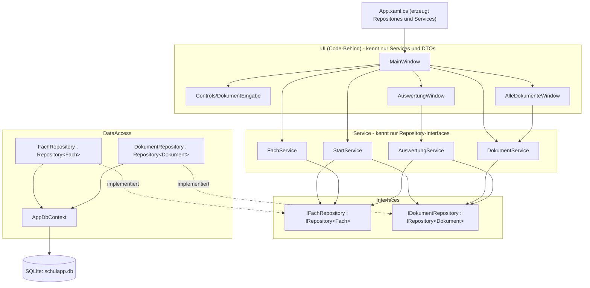

# K3 - Interfaces, Repository, DTOs

Über dem EF-Core-Code aus K2 liegt neu eine formale Ebene: Die Services kennen vom
Datenzugriff nur noch Interfaces, die DataAccess-Klassen sind Repository-Klassen, und
die UI arbeitet mit DTOs statt mit Entities. Die Funktionalität ist gleich geblieben.

Diagramm und Tabelle hier ersetzen den Stand aus `K1_Schichtenarchitektur.md`.

## Schichten nach K3

## B1 - Interface

`DataAccess/IRepository.cs` definiert `GetAll`, `GetById`, `Add`, `Update`, `Delete`.

**Passen die fünf Methoden für alle Entitäten?** Als Grundlage ja, aber sie reichen
nicht. Deshalb gibt es pro Entität ein abgeleitetes Interface mit den Zusätzen:

| Interface             | Zusätzliche Methoden                                  | Wozu                                               |
|-----------------------|-------------------------------------------------------|----------------------------------------------------|
| `IFachRepository`     | `GetAlleMitDokumenten()`                              | Fächerliste und Auswertung brauchen die Dokumente dazu |
|                       | `ExistiertName(name, ausserId)`                       | Regel "Fachname ist eindeutig"                     |
| `IDokumentRepository` | `GetByFach(fachId)`                                   | Dokumente des gewählten Fachs                      |
|                       | `GetOffeneFristen()`                                  | Fristenübersicht                                   |
|                       | `Suche(suchtext, filter, sortierung)`                 | Fenster "Alle Dokumente"                           |
|                       | `SetAbgegeben(id, abgegeben)`                         | Kernprozess, ändert genau eine Spalte              |

`Add` gibt nichts mehr zurück (vorher die neue Id): EF Core trägt die Id in die
übergebene Entität ein, der Service liest sie von dort.

## B2 - DataAccess wird Repository

- `FachDataAccess` -> `FachRepository`, `DokumentDataAccess` -> `DokumentRepository`
  (mit `git mv`, der Ordner `DataAccess/` bleibt).
- Alle vier Services bekommen ihre Repositories über den Konstruktor als Interface-Typ.
- Erzeugt werden die konkreten Klassen an genau einer Stelle: `App.xaml.cs`
  (`OnStartup`). Dort entstehen auch die Services; das Hauptfenster bekommt sie über
  seinen Konstruktor und reicht sie an die Unterfenster weiter. `StartupUri` in
  `App.xaml` ist dafür entfallen.

## B3 - DTOs

| Entity / Daten       | DTO                 | Braucht es ein DTO?                                                                 |
|----------------------|---------------------|-------------------------------------------------------------------------------------|
| `Dokument`           | `DokumentDto`       | Ja: Die Fristenliste und "Alle Dokumente" zeigen den Fachnamen, der nur über die Navigation Property erreichbar ist. Dazu kommen fertige Anzeigetexte. |
| `Fach`               | `FachDto`           | Ja (Challenge): enthält zwei aus den Dokumenten berechnete Kennzahlen.              |
| Auswertung           | `FachAuswertungDto` | War schon ein reines Datenobjekt (`Models/FachAuswertung`), jetzt bei den DTOs.     |

Das Mapping geschieht manuell in der Serviceklasse (`ZuDto` mit `Select`), ohne
AutoMapper. Die Entities enthalten dafür nur noch Tabellenspalten, Navigation Properties
und fachliche Regeln (`Dokument.FristDatum`, `HatFrist`, `IstUeberfaellig`). Alle
Anzeigetexte (`FristAnzeige`, `RestText`, `StatusText`, `Initialen`, ...) werden beim
Mapping berechnet und stehen als einfache Eigenschaften im DTO. Die XAML-Bindings sind
gleich geblieben, weil die DTOs dieselben Eigenschaftsnamen verwenden.

Die UI (`MainWindow`, `AuswertungWindow`, `AlleDokumenteWindow`) verwendet nur noch
DTOs. `SchulApp.Models` braucht einzig `AlleDokumenteWindow` noch - für die Enums
`DokumentFilter` und `DokumentSortierung`.

## Wer ruft wen?

| Serviceklasse     | Service-Methode                                   | Aufruf in Repository (über Interface)                         |
|-------------------|---------------------------------------------------|---------------------------------------------------------------|
| StartService      | Initialisiere()                                   | DbInitializer.Initialize(), IFachRepository.GetAll(), IFachRepository.Add(fach), IDokumentRepository.Add(dokument) |
| FachService       | GetAlle()                                         | IFachRepository.GetAlleMitDokumenten()                        |
| FachService       | Hinzufuegen(name, lehrperson)                     | IFachRepository.ExistiertName(name), IFachRepository.Add(fach) |
| FachService       | Loeschen(fachId)                                  | IFachRepository.Delete(fachId)                                |
| DokumentService   | GetByFach(fachId)                                 | IDokumentRepository.GetByFach(fachId)                         |
| DokumentService   | GetOffeneFristen()                                | IDokumentRepository.GetOffeneFristen()                        |
| DokumentService   | Suche(suchtext, filter, sortierung)               | IDokumentRepository.Suche(suchtext, filter, sortierung)       |
| DokumentService   | Hinzufuegen(titel, typ, dateipfad, frist, fachId) | IDokumentRepository.Add(dokument)                             |
| DokumentService   | Loeschen(dokumentId)                              | IDokumentRepository.Delete(dokumentId)                        |
| DokumentService   | AbgabeUmschalten(dokument)                        | IDokumentRepository.SetAbgegeben(id, neuerStatus)             |
| DokumentService   | MarkiereAlsAbgegeben(dokumentId)                  | IDokumentRepository.SetAbgegeben(id, true)                    |
| DokumentService   | ZaehleOffene(dokumente), ZaehleUeberfaellige(dokumente) | - (rechnen auf der bereits geladenen DTO-Liste)         |
| AuswertungService | GetAuswertungProFach()                            | IFachRepository.GetAlleMitDokumenten()                        |
| AuswertungService | GetGesamtauswertung()                             | IDokumentRepository.GetAll()                                  |

## B4 - Kontrolle

- Suche nach `new FachRepository` / `new DokumentRepository`: nur in `App.xaml.cs`.
- In `Services/` kommen nur die Typen `IFachRepository` und `IDokumentRepository` vor,
  nie die konkreten Klassen.
- Kein Fenster hat ein `using SchulApp.DataAccess`.

## Vertiefung: Generische Basisklasse

`DataAccess/Repository.cs` setzt die fünf Standardmethoden einmal mit
`context.Set<T>()` um. `FachRepository` und `DokumentRepository` erben davon.

- Aus der Basisklasse übernommen: `GetById` und `Delete` (beide Repositories), `GetAll`
  (Dokumente).
- Überschrieben: `GetAll` bei Fächern (alphabetisch), `Add`/`Update` in beiden - dort
  werden nur noch die Texte bereinigt, gespeichert wird über `base.Add` / `base.Update`.
- Eingespart: Die beiden Klassen sind zusammen von 279 auf 204 Zeilen geschrumpft, die
  Basisklasse hat 51 Zeilen. Wichtiger als die Zeilenzahl: Speichern, Ändern und Löschen
  stehen nur noch einmal im Code, und eine dritte Entität bekäme alle fünf Methoden mit
  einer einzigen Zeile Klassendeklaration.

## Challenge: Zweites DTO mit komplexerem Mapping

`FachDto` wird in `FachService.ZuDto` aus einem `Fach` samt seiner Navigation Property
`Dokumente` gebildet. Das Mapping enthält zwei Berechnungen:

- `AnzahlDokumente` = Anzahl Dokumente des Fachs,
- `AnzahlOffen` = Anzahl Dokumente mit `Abgegeben == false`.

Sichtbar in der Fächerliste: "M. Keller · 3 Dokumente · 2 offen". Der Zusatz "offen" ist
neu und erscheint nur, wenn etwas offen ist.

Bewusst **nicht** im DTO:

| Feld                | Warum nicht                                                                 |
|---------------------|-----------------------------------------------------------------------------|
| `Fach.Erstellt`     | Wird nirgends angezeigt - internes Feld.                                    |
| `Fach.Dokumente`    | Die UI braucht nur die zwei Zahlen; die Dokumente lädt sie separat als `DokumentDto`. So verlässt keine Entity die Service-Schicht. |
| `Dokument.FachId`   | Fremdschlüssel; die UI braucht nur den Fachnamen.                           |
| `Dokument.Dateipfad`| Angezeigt wird nur der Dateiname (`DateiAnzeige`).                          |
| `Dokument.Frist`    | Rohtext im Speicherformat; die UI bekommt `FristAnzeige` und `RestText`.    |

Abwägung gegenüber K2: Vorher zählte die Datenbank die Dokumente pro Fach
(`Select(... f.Dokumente.Count)`), jetzt werden die Dokumente mit `Include()` geladen
und im Mapping gezählt. Das ist bei den Datenmengen dieser App unproblematisch und
bleibt eine einzige Abfrage.

## Reflexion & KI-Protokoll (K3)

Fortsetzung des Protokolls aus K0-K2.

| Nr | Thema | Prompt (Kernfrage) | Was die KI geliefert hat | Gut / korrigiert | Gelernt |
|----|-------|--------------------|--------------------------|------------------|---------|
| K3-1 | Interfaces und Repository (B1, B2) | "Weiter mit K3" - K3-Unterlagen als Vorgabe, bestehender Code als Kontext. | `IRepository<T>`, abgeleitete Interfaces pro Entität, Umbenennung der DataAccess-Klassen, Konstruktor-Injection in allen Services, Verdrahtung in `App.xaml.cs`. | _TODO Team_ | _TODO Team_ |
| K3-2 | DTOs und Mapping (B3) | Teil von K3-1. | `DokumentDto`, `FachDto`, `FachAuswertungDto`; manuelles Mapping `ZuDto` in den Services; Anzeige-Eigenschaften aus den Entities entfernt; Fenster auf DTOs umgestellt. | _TODO Team_ | _TODO Team_ |
| K3-3 | Generische Basisklasse und zweites DTO (Vertiefung, Challenge) | Teil von K3-1. | `Repository<T>` mit `context.Set<T>()`; `FachDto` mit berechneten Kennzahlen. | _TODO Team_ | _TODO Team_ |

Fragen aus Kapitel 7 - bitte aus eigener Erfahrung beantworten:

- **Welche Prompts habt ihr verwendet, um Interfaces und Repository-Pattern einzuführen?** _TODO Team_
- **Was hat die KI beim Mapping Entity/DTO gut gemacht - wo musstet ihr korrigieren?** _TODO Team_
- **Wo wollte die KI zu schnell AutoMapper oder ähnliche Bibliotheken einführen - und wie habt ihr sie zurückgeholt?** _TODO Team_ (In dieser Sitzung wurde kein AutoMapper vorgeschlagen; das Mapping ist von Hand geschrieben.)
- **Bei welcher Entity hat sich ein DTO klar gelohnt - bei welcher nicht? Warum?** _TODO Team_ (Ausgangspunkt: Tabelle in Abschnitt B3.)
