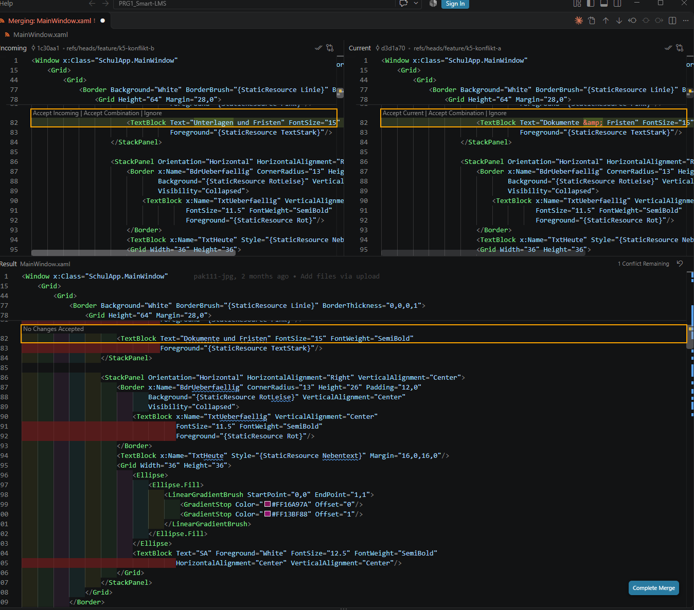

# K5 - Git und Kollaboration

K5 macht den Weg von K0 bis K4 im Git-Verlauf sichtbar. An der App selbst ändert sich
nur eine Kleinigkeit (Einstellungsdatei, siehe B2) - sie dient gleichzeitig als "kleine,
echte Anpassung" für den Pull-Request-Workflow (B3).

## B1 - Git-Verlauf

Stand von `main` (nur Merge-Commits, `git log --first-parent main`):

| Merge-Commit | Datum | Pull Request | Branch | K-Schritt |
|--------------|-------|--------------|--------|-----------|
| `a2d888d` | 21.08.2026 | - | erster Upload | K0 |
| `a29f9d4` | 21.09.2026 | #1 | `feature/k1-schichten` | K1 Basis |
| `eab3d2b` | 23.10.2026 | #2 | `feature/k2-efcore` | K2 Basis |
| `37716b2` | 13.11.2026 | #3 | `feature/k0-wpf-vertiefung` | K0-Z |
| `5578c06` | 13.11.2026 | #4 | `feature/k1-schichten-abschluss` | K1 Challenge |
| `ba07f34` | 13.11.2026 | #5 | `feature/k2-efcore-abschluss` | K2 Challenge |
| `0f081b4` | 13.11.2026 | #6 | `feature/k3-interfaces-repository` | K3 |
| `d469e8f` | 13.11.2026 | #7 | `feature/k4-cleancode-testing` | K4 |

Befund:

- Jeder Umbauschritt K1-K4 ist als eigener Branch nach dem Schema `feature/kN-thema`
  und als Pull Request sichtbar. Rückwirkende Branches waren nicht nötig.
- K0 ist nur als einzelner Upload-Commit ("Add files via upload") vorhanden - der
  K0-Stand ist damit nachvollziehbar, aber ohne Zwischenschritte.
- Die Branch-Namen weichen bei K3 bis K5 leicht von den Vorschlägen der Unterlagen ab
  (`feature/k3-interfaces-repository` statt `feature/k3-repository-dto`), folgen aber
  demselben Schema.
- K3 bis K5 und die Nachträge zu K0 bis K2 wurden alle am 13.11.2026 gemergt.

## B2 - .gitignore und Secrets

**Kontrolle der gesamten Historie** (alle Branches, alle Commits):

- Suche nach `password`, `pwd=`, `api key`, `secret`, `token`, `Server=`, `User Id=`
  in allen Diffs: keine Treffer.
- Suche nach versehentlich versionierten Dateien (`bin/`, `obj/`, `.vs/`, `*.db`,
  `*.user`, `appsettings*.json`): keine Treffer.
- Die einzige Verbindungszeichenfolge im Code ist `Data Source=schulapp.db` - ein
  lokaler Dateiname ohne Zugangsdaten, also kein Secret.

**Umgesetzt:**

- `appsettings.Example.json` mit Platzhalter angelegt.
- `DataAccess/Datenbankeinstellungen.cs`: Liegt neben der App eine `appsettings.json`,
  gilt deren Wert `ConnectionStrings:SchulApp`; sonst die lokale SQLite-Datei wie bisher.
  Der feste Text in `DbInitializer` ist entfallen.
- `.gitignore` ergänzt: `appsettings.json` und `appsettings.*.json` (ausser der
  Vorlage), `*.db-journal`, `TestResults/`, Coverage-Dateien, `*.rsuser`.

Sollte die App später eine Server-Datenbank mit Passwort verwenden, steht die echte
Verbindungszeichenfolge nur in der lokalen `appsettings.json`.

## B3 - Pull-Request-Workflow

Der Branch `feature/k5-git-workflow` enthält eine kleine, echte Anpassung (B2) und wird
wie die vorherigen Schritte als Pull Request nach `main` gestellt.

- Pull Request: _TODO Team: Link_
- Erstellt von: _TODO Team_
- Review durch: _TODO Team_ (nicht dieselbe Person)
- Kommentare aus dem Review und was daraufhin geändert wurde: _TODO Team_
- Gemergt durch die reviewende Person: _TODO Team: ja/nein_

Vorschlag für die Pull-Request-Beschreibung:

> **Was:** Verbindungszeichenfolge über optionale `appsettings.json` (Vorlage
> `appsettings.Example.json`), `.gitignore` ergänzt, README mit Lernweg K0-K5, K5-Doku.
> **Warum:** K5 B2 - echte Einstellungen gehören nicht ins Repository; ohne Datei
> verhält sich die App wie bisher.
> **Bitte prüfen:** Startet die App ohne `appsettings.json` unverändert? Wird eine
> lokale `appsettings.json` von Git ignoriert (`git status`)?

## B4 - Merge-Konflikt provozieren und lösen

Durchgeführt am 13.11.2026 an der Zeile mit dem Untertitel in der Kopfleiste
(`MainWindow.xaml`, Zeile 82). Ausgangstext auf `main`: `Text="Dokumente und Fristen"`.

| Schritt | Branch | Commit | Inhalt |
|---------|--------|--------|--------|
| Variante A | `feature/k5-konflikt-a` | `d3d1a70` | Zeile geändert auf `Text="Dokumente &amp; Fristen"` (angezeigt: "Dokumente & Fristen") |
| Variante B | `feature/k5-konflikt-b` | `1c30aa1` | dieselbe Zeile geändert auf `Text="Unterlagen und Fristen"` |
| Merge | `feature/k5-konflikt-a` | `62bf24c` | `git merge feature/k5-konflikt-b` meldete `CONFLICT (content)` in `MainWindow.xaml`; Konflikt gelöst und Merge committet |

**Konfliktstelle:**

```
<<<<<<< HEAD
                        <TextBlock Text="Dokumente &amp; Fristen" FontSize="15" FontWeight="SemiBold"
=======
                        <TextBlock Text="Unterlagen und Fristen" FontSize="15" FontWeight="SemiBold"
>>>>>>> feature/k5-konflikt-b
```

Oberhalb von `=======` steht die Version des aktuellen Branches (`HEAD`, Variante A),
unterhalb die Version des hereingeholten Branches (Variante B). Beide Branches hatten
dieselbe Zeile gegenüber `main` unterschiedlich geändert - deshalb konnte Git nicht
selbst entscheiden.

**Mergetool:** Merge-Editor von Visual Studio Code. Der Screenshot zeigt den offenen
Konflikt vor der Entscheidung: oben links "Incoming" (Variante B, Commit `1c30aa1`),
oben rechts "Current" (Variante A, Commit `d3d1a70`), unten das Resultat, in dem zu
diesem Zeitpunkt noch der alte Text von `main` steht ("1 Conflict Remaining").



**Gewählte Version:** Variante A, "Dokumente & Fristen" ("Accept Current").

**Begründung:** Die App verwendet überall den Begriff "Dokumente" (Menü, Tabelle,
Schaltfläche "Dokument ablegen"). Variante B hätte mit "Unterlagen" einen zweiten
Begriff für dieselbe Sache eingeführt; Variante A bleibt beim eingeführten Begriff und
ist nur kürzer.

**Nachweis im Git-Verlauf:**

```
git log --graph --oneline feature/k5-konflikt-a
git show d3d1a70 -- MainWindow.xaml
git show 1c30aa1 -- MainWindow.xaml
```

Der Graph zeigt, dass `d3d1a70` und `1c30aa1` vom selben Stand von `main` abzweigen und
im Merge-Commit `62bf24c` wieder zusammenlaufen; die beiden `git show` zeigen, dass
beide dieselbe Zeile ändern.

- Pull Request nach `main`: _TODO Team: Link_
- Grösste Hürde und was ihr daraus mitnehmt: _TODO Team_

## Vertiefung: Lernweg dokumentieren

`README.md` im Wurzelverzeichnis fasst den Lernweg K0-K5 mit Branches, wichtigsten
Commits und Links auf die Pull Requests #1 bis #7 zusammen. Der Link auf den
K5-Pull-Request ist dort noch als TODO markiert.

## Challenge: Versionen taggen

Noch nicht gesetzt. Befehle (annotierte Tags auf die Merge-Commits von `main`):

```
git tag -a v1.0-k0 37716b2 -m "K0 abgeschlossen: App, WPF-Vertiefung, KI-Protokoll"
git tag -a v1.0-k1 5578c06 -m "K1 abgeschlossen: Schichtenarchitektur"
git tag -a v1.0-k2 ba07f34 -m "K2 abgeschlossen: EF Core"
git tag -a v1.0-k3 0f081b4 -m "K3 abgeschlossen: Interfaces, Repository, DTOs"
git tag -a v1.0-k4 d469e8f -m "K4 abgeschlossen: Clean Code und Unit Tests"
git push origin --tags
```

`v1.0-k5` folgt auf den Merge-Commit des K5-Pull-Requests.

**Wofür Tags nützlich sind:** Eine Commit-Message beschreibt, was sich in genau diesem
Commit geändert hat. Ein Tag gibt einem bestimmten Stand des ganzen Projekts einen
festen, sprechenden Namen. Damit lässt sich z. B. der Stand "nach K2" direkt auschecken
(`git switch --detach v1.0-k2`) oder mit einem anderen vergleichen
(`git diff v1.0-k2 v1.0-k3`), ohne Commit-Hashes heraussuchen zu müssen. Tags
verschieben sich nicht, wenn weitere Commits dazukommen - im Unterschied zu einem Branch.

## Git-Verlauf als Leistungsnachweis - Checkliste

| Punkt | Stand |
|-------|-------|
| `main` ist stabil, die App startet fehlerfrei | _TODO Team: mit .NET 10 bestätigen_ (geprüft wurde in einer Kopie mit .NET 8: App startet, 39 Tests grün) |
| Für K1-K4 ist je ein Branch/Commit sichtbar | erfüllt, siehe B1 |
| Keine Secrets im Verlauf | erfüllt, siehe B2 |
| Verlauf ohne Erklärung verständlich | Branch-Namen und Commit-Messages sprechend; README als Einstieg |

## Reflexion & KI-Protokoll (K5)

Abschluss des Protokolls aus K0-K4.

| Nr | Thema | Prompt (Kernfrage) | Was die KI geliefert hat | Gut / korrigiert | Gelernt |
|----|-------|--------------------|--------------------------|------------------|---------|
| K5-1 | Verlauf und Secrets prüfen (B1, B2) | "Weiter mit K5" - K5-Unterlagen als Vorgabe. | Auswertung von `git log` über alle Branches, Suche nach Secrets und versehentlich versionierten Dateien: keine Treffer. | _TODO Team_ | _TODO Team_ |
| K5-2 | .gitignore und Einstellungsdatei (B2, Prompt 3) | Teil von K5-1. | Ergänzungen in `.gitignore`, `appsettings.Example.json`, Klasse `Datenbankeinstellungen` mit vier Tests. | _TODO Team_ | _TODO Team_ |
| K5-3 | README, PR-Beschreibung, Tags (Vertiefung, Challenge, Prompt 2) | Teil von K5-1. | `README.md` mit Lernweg, Vorschlag für die PR-Beschreibung, Tag-Befehle. | _TODO Team_ | _TODO Team_ |
| K5-4 | Merge-Konflikt verstehen (Prompt 1) | _TODO Team: nach der Übung in B4_ | _TODO_ | _TODO_ | _TODO_ |

Fragen aus Kapitel 7 - bitte aus eigener Erfahrung beantworten:

- **Welche Prompts habt ihr verwendet, um Konflikte zu verstehen oder PR-Texte zu formulieren?** _TODO Team_
- **Wie ist der Pull-Request-Workflow in der Gruppe gelaufen - was hat das Review gebracht?** _TODO Team_
- **Was war die grösste Hürde beim Merge-Konflikt - und wie habt ihr sie gelöst?** _TODO Team_
- **Zeigt der gesamte Git-Verlauf von K0 bis K5 euren Lernweg nachvollziehbar? Was würdet ihr rückblickend anders machen?** _TODO Team_
